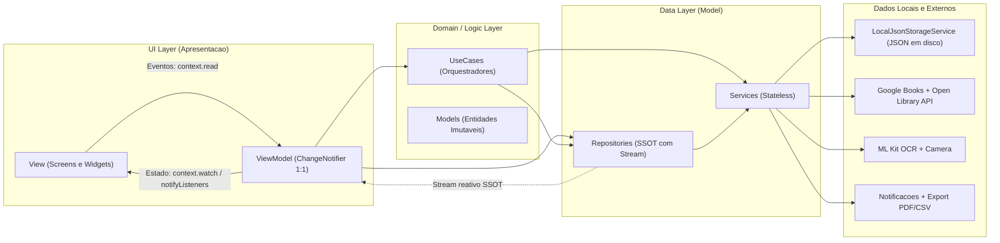
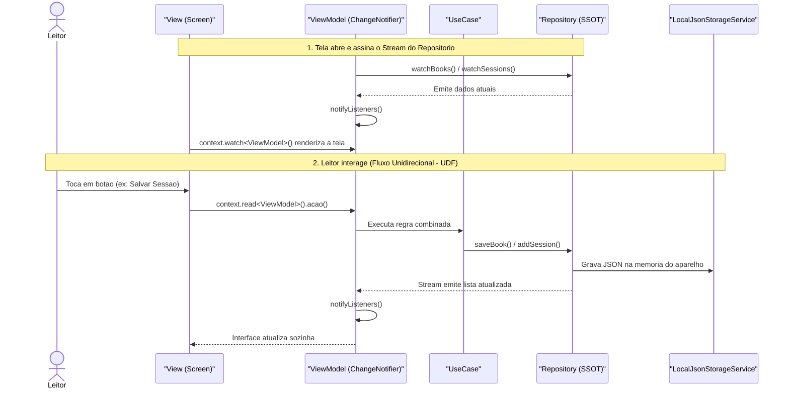
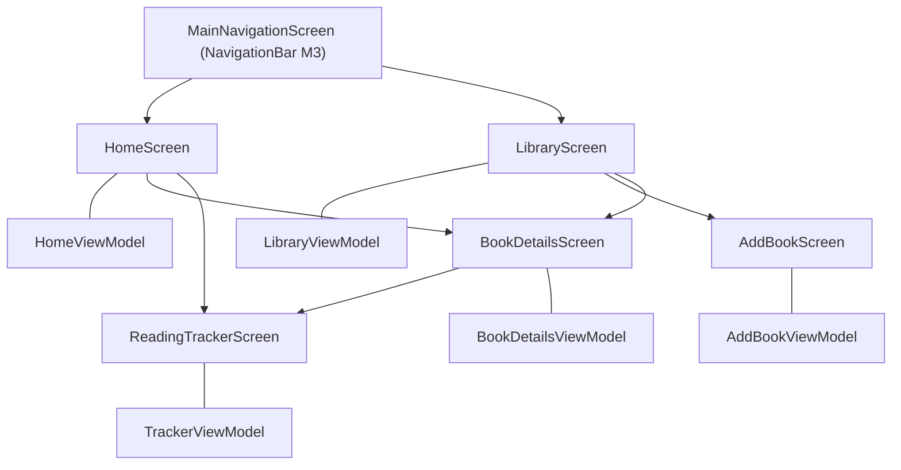
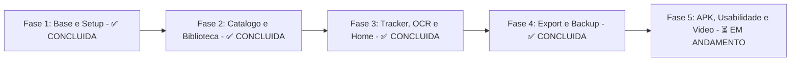

# 📚 BOOKY — Biblioteca Pessoal & Rastreamento de Leitura

> **Disciplina:** Programação para Dispositivos Móveis (2026.2 — UFRN)  
> **Professor:** Taniro Chacon Rodrigues  
> **Tema 6:** App de Biblioteca Pessoal e Rastreamento de Leitura  
> **Arquitetura:** MVVM + Camadas + UDF + SSOT (`Aula_24_-_Arqutietura_Recomendada.pdf`)  
> **Persistência Oficial:** 100% Offline-First com `LocalJsonStorageService` (arquivos JSON locais)  
> **Status Atual:** **Fases 1 a 4 Concluídas ✅** · **46/46 Testes Passando ✅** · **Fase 5 (APK no aparelho + Vídeo) ⏳**

---

## 1. Visão Geral & Arquitetura Visual (MVVM + UDF + SSOT)

O **BOOKY** organiza acervos físicos e digitais, acompanha sessões e metas de leitura, extrai citações de páginas físicas via OCR e controla empréstimos com alertas locais.

### Fluxo de Dados na Prática (Como tudo se conversa)



### Como `View` e `ViewModel` se comunicam (Passo a Passo)



### Estrutura de Pastas (`lib/`)

```text
lib/
├── main.dart                     # Inicializa DI (ConfigureProviders) e MaterialApp (Tema + Rotas)
├── core/
│   ├── constants/                # Nome do app (BOOKY)
│   ├── di/                       # ConfigureProviders: cria e injeta Services, Repositories e UseCases
│   ├── routes/                   # AppRoutes (/main, /add-book, /book-details, /tracker)
│   └── theme/                    # AppColors (paleta estrita 5 tons), AppTheme (M3 Light/Dark) e ThemeController
├── domain/
│   ├── models/                   # BookModel, ShelfModel, ReadingSessionModel, NoteModel, LoanModel, AppSettingsModel
│   ├── repositories/             # 6 interfaces abstratas SSOT (contratos)
│   └── use_cases/                # DeleteBook, ExportLibrary, GetDashboardStats, RegisterLoan, ReturnLoan, RestoreBackup, SaveReadingSession
├── data/
│   ├── services/                 # StorageService (LocalJson / InMemory), BookApiService, OcrService, NotificationService, ExportService, BackupSyncService
│   └── repositories/             # 6 implementacoes SSOT reativas (sem dependencia entre repositorios)
└── features/                     # Telas (View) + ViewModels (1:1)
    ├── home/                     # MainNavigationScreen (NavigationBar M3), HomeScreen + HomeViewModel + ReadingChartsSection
    ├── library/                  # LibraryScreen + LibraryViewModel, AddBookScreen + AddBookViewModel + Modais (Filtros, Estantes, Export/Backup)
    ├── book_details/             # BookDetailsScreen + BookDetailsViewModel + Dialogs (Emprestimo, Notas/OCR)
    └── tracker/                  # ReadingTrackerScreen + TrackerViewModel
```

---

## 2. Mapa das Telas e Dependências (1:1)



---

## 3. Cobertura dos Requisitos (Tema 6 + Aulas da Disciplina)

| Requisito / Aula | Status | O que está funcionando no projeto |
| :--- | :---: | :--- |
| **RF1 — ISBN (Scanner + API)** | ✅ | [`BookApiService`](file:///media/natan_luc/HD%201TB/projetos/booky/lib/data/services/book_api_service.dart) consulta Google Books com fallback na Open Library; [`AddBookScreen`](file:///media/natan_luc/HD%201TB/projetos/booky/lib/features/library/presentation/screens/add_book_screen.dart) usa `mobile_scanner` com trava de frame e revisão manual |
| **RF2 — Estantes, Formato & Status** | ✅ | 4 status (`wantToRead`, `reading`, `read`, `abandoned`), formato (`physical`, `digital`), notas `0..5`, tags, estantes N:N e limpeza automática de `shelfIds` ao excluir estante |
| **RF3 — Rastreador & Sessões** | ✅ | Cronômetro por timestamp resistente a segundo plano, sincronia página ↔ `%`, histórico diário (`YYYY-MM-DD`) e estimativa sem risco de `NaN`/`Infinity` |
| **RF4 — Diário & OCR** | ✅ | 3 abas (`Anotações`, `Citações`, `Resenha`) em [`BookDetailsScreen`](file:///media/natan_luc/HD%201TB/projetos/booky/lib/features/book_details/presentation/screens/book_details_screen.dart) + OCR 100% offline via ML Kit removendo foto temporária |
| **RF5 — Empréstimos** | ✅ | Bloqueia 2 empréstimos ativos no mesmo livro, agenda/cancela notificação local e exibe alerta visual `ATRASADO` (`LoanModel.isOverdue`) |
| **RF6 — Busca Avançada & Gráficos** | ✅ | Filtros `AND` combinados (autor, gênero, ano, status, nota, estante, tag) + gráficos `fl_chart` (livros e páginas/mês) + meta anual editável |
| **RF7 — Exportação & Backup** | ✅ | PDF (Unicode PT-BR) + CSV (BOM UTF-8) via `share_plus` + Backup/Restore JSON com atualização em tempo real dos Streams (`RestoreBackupUseCase`) *(obs.: nuvem adaptada para JSON offline-first)* |
| **Design Editorial Stitch & Material 3** | ✅ | Paleta estrita de 5 tons (`AppColors`), Light/Dark Mode, `NavigationBar` + `NavigationDestination` (`Aula 16`) |
| **Arquitetura (`Aula 24`) & Qualidade** | ✅ | MVVM 1:1, UseCases, Services *stateless*, 6 repositórios SSOT isolados, `flutter analyze` com 0 erros/warnings e **46/46 testes passando** |

---

## 4. Plano do Projeto em Fases (O que já foi vs. O que falta)



### Fase 1 — Fundação Arquitetural, Contratos & Setup Android (`✅ Concluída`)
- [x] `pubspec.yaml` enxuto com apenas as dependências necessárias (sem pacotes órfãos).
- [x] `AppColors` (5 tons Light/Dark), `AppTheme` (Material 3 + `navigationBarTheme`), `ThemeController`, `AppRoutes` e `ConfigureProviders`.
- [x] `MainNavigationScreen` utilizando `NavigationBar` e `NavigationDestination` (`Aula 16`).
- [x] Configuração Android pronta para build (`namespace br.ufrn.booky`, `AGP 9.1.1`, `minSdk = 23`, `desugaring`, permissões de câmera, internet e notificações).
- [x] 6 Models imutáveis + 6 Repositórios SSOT + **`LocalJsonStorageService`** definido como persistência oficial offline.

### Fase 2 — Catalogação, Biblioteca, Estantes & Busca Avançada (`✅ Concluída`)
- [x] `BookApiService` (Google Books + fallback Open Library + testes `MockClient`).
- [x] `AddBookViewModel` + `AddBookScreen` (scanner ISBN com trava de frame + cadastro/edição completo).
- [x] `LibraryViewModel` + `LibraryScreen` (filtros combinados, gestão de estantes limpando `book.shelfIds` no `deleteShelf`, badges de empréstimo/atraso).

### Fase 3 — Rastreador de Leitura, Diário com OCR, Empréstimos & Dashboard (`✅ Concluída`)
- [x] `SaveReadingSessionUseCase` + `TrackerViewModel` + `ReadingTrackerScreen`.
- [x] `OcrService` + `BookDetailsViewModel` + `BookDetailsScreen` + `DeleteBookUseCase`.
- [x] `NotificationService` + `RegisterLoanUseCase` + `ReturnLoanUseCase`.
- [x] `GetDashboardStatsUseCase` + `HomeViewModel` + `HomeScreen` + `ReadingChartsSection` (`fl_chart`).

### Fase 4 — Exportação, Backup & Conformidade de Camadas (`✅ Concluída`)
- [x] `ExportService` (PDF Unicode + CSV UTF-8 + `share_plus`) + `ExportLibraryUseCase`.
- [x] `BackupSyncService` + `RestoreBackupUseCase` (recarrega os 6 repositórios SSOT na hora após restaurar JSON).
- [x] `ExportDataSheet` totalmente desacoplado via callbacks do `LibraryViewModel`.

### Fase 5 — Qualidade, APK, Usabilidade & Vídeo (`⏳ Falta só APK + Vídeo`)
- [x] 12 suítes de testes automatizados em `test/`.
- [x] `flutter analyze` com **0 erros/warnings** e `flutter test` com **46/46 testes passando**.
- [ ] **Gerar o APK release** (`flutter build apk --release`) e testar usabilidade em celular Android físico.
- [ ] **Gravar o vídeo de apresentação** demonstrando o app funcionando e explicando a arquitetura MVVM.

---

## 5. Guia Rápido para o Cleiton — APK, Testes no Celular e Vídeo

### Passo 1 — Gerar e Instalar o APK
No terminal, dentro da pasta do projeto:
```bash
flutter pub get
flutter build apk --release
```
O APK será gerado em: `build/app/outputs/flutter-apk/app-release.apk`.

### Passo 2 — Checklist de Usabilidade no Celular Físico
- [ ] **Com internet:** escanear ou digitar um ISBN na `AddBookScreen` e confirmar preenchimento automático (Google Books / Open Library).
- [ ] **Câmera / OCR:** abrir detalhes de um livro → aba *Citações* → extrair texto de uma página física via câmera.
- [ ] **Rastreador:** iniciar cronômetro, minimizar/bloquear brevemente o app e voltar para confirmar que o tempo continuou contando; atualizar página/`%` e salvar sessão.
- [ ] **Empréstimo:** emprestar um livro para um amigo, confirmar badge na biblioteca e testar devolução.
- [ ] **Persistência Offline:** fechar o app completamente, abrir de novo e confirmar que livros, notas, sessões e meta anual continuam salvos.
- [ ] **Exportação & Tema:** gerar PDF e CSV, testar alternância Light/Dark Mode e conferir se não há corte de texto ou overflow (`Aula 23`).

### Passo 3 — Roteiro do Vídeo de Apresentação (Exigência da Disciplina)
1. **Demonstração Prática (Telas & Requisitos):**
   - Cadastro via ISBN (câmera/busca) + manual; organização por status, tags e estantes;
   - Busca avançada combinada na Biblioteca;
   - Rastreador de leitura (cronômetro + página/`%` + histórico + estimativa);
   - Diário do livro (anotações, citações com OCR da câmera, resenha com estrelas);
   - Empréstimos (cadastro, badge/alerta de atraso, devolução);
   - Dashboard (`HomeScreen` com gráficos `fl_chart` e meta anual) + exportação PDF/CSV + fechar e reabrir o app provando persistência local.
2. **Explicação da Arquitetura MVVM no Código:**
   - Mostrar a árvore de pastas (`core/`, `domain/`, `data/`, `features/`) e o `ConfigureProviders` montando a injeção de dependências;
   - Explicar cada camada: **Model** (`BookModel`, `BookRepositoryImpl`, `LocalJsonStorageService`/`BookApiService`), **UseCase** (`SaveReadingSessionUseCase`), **ViewModel** (`TrackerViewModel`) e **View** (`ReadingTrackerScreen`);
   - Mostrar no código como **View e ViewModel se comunicam**: `context.watch<VM>()` para reagir às mudanças da UI e `context.read<VM>()` para disparar ações que atualizam o repositório e disparam `notifyListeners()`.

*(Nota sobre o RF7 na apresentação: explicar que o app foi projetado como 100% offline-first sem Firebase, garantindo portabilidade entre dispositivos via exportação/restauração de backup JSON no `BackupSyncService`.)*

---

## 6. Referência Futura: Esquema SQLite (Caso o Projeto Evolua)

A persistência atual oficial é o **`LocalJsonStorageService`**. Caso em uma versão futura o projeto migre para SQLite (`sqflite`), basta criar `SqliteStorageService implements StorageService` usando o esquema abaixo sem alterar telas ou ViewModels:

```sql
CREATE TABLE IF NOT EXISTS app_settings (
    id TEXT PRIMARY KEY NOT NULL,
    annual_goal INTEGER NOT NULL DEFAULT 12,
    reminder_enabled INTEGER NOT NULL DEFAULT 0,
    reminder_hour INTEGER NOT NULL DEFAULT 20,
    reminder_minute INTEGER NOT NULL DEFAULT 0,
    updated_at TEXT NOT NULL
);

CREATE TABLE IF NOT EXISTS books (
    id TEXT PRIMARY KEY NOT NULL,
    isbn TEXT,
    title TEXT NOT NULL,
    author TEXT NOT NULL,
    publisher TEXT,
    published_year INTEGER,
    genre TEXT,
    synopsis TEXT,
    cover_url TEXT,
    total_pages INTEGER NOT NULL DEFAULT 0,
    current_page INTEGER NOT NULL DEFAULT 0,
    status TEXT NOT NULL CHECK (status IN ('wantToRead', 'reading', 'read', 'abandoned')),
    format TEXT NOT NULL CHECK (format IN ('physical', 'digital')),
    rating REAL,
    tags TEXT NOT NULL DEFAULT '[]',
    shelf_ids TEXT NOT NULL DEFAULT '[]',
    started_at TEXT,
    finished_at TEXT,
    created_at TEXT NOT NULL,
    updated_at TEXT NOT NULL
);

CREATE TABLE IF NOT EXISTS shelves (
    id TEXT PRIMARY KEY NOT NULL,
    name TEXT NOT NULL,
    description TEXT,
    created_at TEXT NOT NULL,
    updated_at TEXT NOT NULL
);

CREATE TABLE IF NOT EXISTS book_shelves (
    book_id TEXT NOT NULL,
    shelf_id TEXT NOT NULL,
    PRIMARY KEY (book_id, shelf_id),
    FOREIGN KEY (book_id) REFERENCES books (id) ON DELETE CASCADE,
    FOREIGN KEY (shelf_id) REFERENCES shelves (id) ON DELETE CASCADE
);

CREATE TABLE IF NOT EXISTS reading_sessions (
    id TEXT PRIMARY KEY NOT NULL,
    book_id TEXT NOT NULL,
    date_key TEXT NOT NULL,
    start_page INTEGER NOT NULL,
    end_page INTEGER NOT NULL,
    pages_read INTEGER NOT NULL,
    duration_seconds INTEGER NOT NULL,
    created_at TEXT NOT NULL,
    FOREIGN KEY (book_id) REFERENCES books (id) ON DELETE CASCADE
);

CREATE TABLE IF NOT EXISTS notes (
    id TEXT PRIMARY KEY NOT NULL,
    book_id TEXT NOT NULL,
    type TEXT NOT NULL CHECK (type IN ('note', 'quote', 'review')),
    chapter TEXT,
    page INTEGER,
    content TEXT NOT NULL,
    created_at TEXT NOT NULL,
    updated_at TEXT NOT NULL,
    FOREIGN KEY (book_id) REFERENCES books (id) ON DELETE CASCADE
);

CREATE TABLE IF NOT EXISTS loans (
    id TEXT PRIMARY KEY NOT NULL,
    book_id TEXT NOT NULL,
    borrower_name TEXT NOT NULL,
    borrower_contact TEXT NOT NULL,
    loan_date TEXT NOT NULL,
    expected_return_date TEXT NOT NULL,
    returned_date TEXT,
    is_returned INTEGER NOT NULL DEFAULT 0,
    notification_id INTEGER,
    updated_at TEXT NOT NULL,
    FOREIGN KEY (book_id) REFERENCES books (id) ON DELETE CASCADE
);
```
