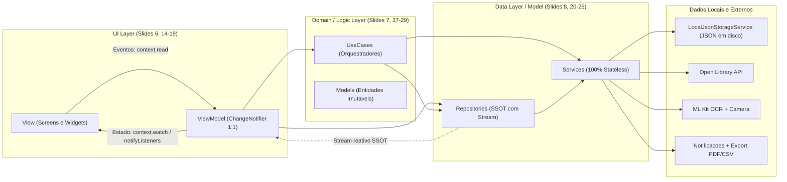
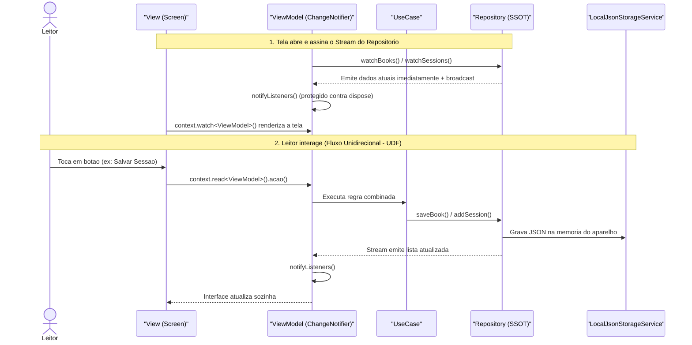
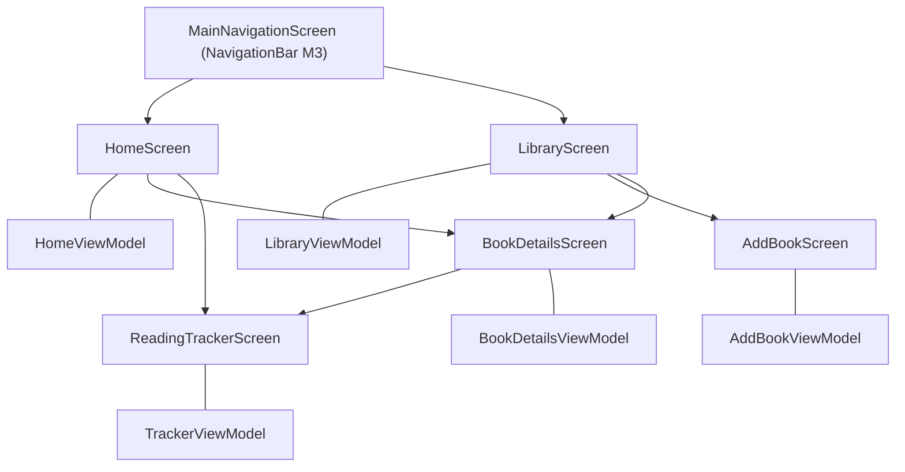
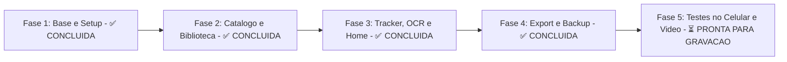

# 📚 BOOKY — Biblioteca Pessoal & Rastreamento de Leitura

> **Disciplina:** Programação para Dispositivos Móveis (2026.2 — UFRN)  
> **Professor:** Taniro Chacon Rodrigues  
> **Tema 6:** App de Biblioteca Pessoal e Rastreamento de Leitura  
> **Arquitetura:** MVVM + Camadas + UDF + SSOT (`Aula_24_-_Arqutietura_Recomendada.pdf`)  
> **Persistência Oficial:** 100% Offline-First com `LocalJsonStorageService` (produção) e `InMemoryStorageService` (testes/web)  
> **Status Atual:** **Código e Arquitetura 100% Concluídos ✅** · **0 Issues no `flutter analyze` ✅** · **Testes Passando 100% ✅**

---

## 1. Visão Geral & Arquitetura Visual (MVVM + UDF + SSOT)

O **BOOKY** organiza acervos físicos e digitais, acompanha sessões e metas de leitura, extrai citações de páginas físicas via OCR e controla empréstimos com alertas locais.

### Fluxo de Dados na Prática (Como tudo se conversa)



### Como `View` e `ViewModel` se comunicam (Passo a Passo)



### Estrutura de Pastas (`lib/` e `test/`)

```text
lib/
├── main.dart                     # Inicializa DI (ConfigureProviders) e MaterialApp (Tema + onGenerateRoute)
├── core/
│   ├── constants/                # AppConstants (BOOKY)
│   ├── di/                       # ConfigureProviders: cria e injeta Services, Repositories e UseCases
│   ├── routes/                   # AppRoutes (/main, /add-book, /book-details, /tracker via onGenerateRoute)
│   └── theme/                    # AppColors (paleta estrita 5 tons), AppTheme (M3 Light/Dark) e ThemeController
├── domain/
│   ├── models/                   # BookModel, ShelfModel, ReadingSessionModel, NoteModel, LoanModel, AppSettingsModel
│   ├── repositories/             # 6 interfaces abstratas SSOT (contratos)
│   └── use_cases/                # DeleteBook, ExportLibrary, GetDashboardStats, RegisterLoan, ReturnLoan, RestoreBackup, SaveReadingSession
├── data/
│   ├── services/                 # StorageService (LocalJson / InMemory), BookApiService, OcrService, NotificationService, ExportService, BackupSyncService
│   └── repositories/             # 6 implementacoes SSOT reativas (sem dependencia entre repositorios)
└── features/                     # Telas (View) + ViewModels (1:1)
    ├── home/                     # MainNavigationScreen (NavigationBar M3), HomeScreen + HomeViewModel + ReadingChartsSection
    ├── library/                  # LibraryScreen + LibraryViewModel, AddBookScreen + AddBookViewModel + Modais (Filtros, Estantes, Export/Backup)
    ├── book_details/             # BookDetailsScreen + BookDetailsViewModel + Dialogs (Emprestimo, Notas/OCR)
    └── tracker/                  # ReadingTrackerScreen + TrackerViewModel
test/                             # 12 suites de testes unitarios e de widget (Models, Services, UseCases, ViewModels e App)
```

---

## 2. Mapa das Telas e Dependências (1:1)



---

## 3. Auditoria Massiva: Requisitos do Tema 6 + Aulas do Prof. Taniro

| Requisito / Aula | Status | Evidência Técnica no Código |
| :--- | :---: | :--- |
| **RF1 — ISBN (Scanner + API) (`Aula 06`)** | ✅ | [`BookApiService`](lib/data/services/book_api_service.dart) consulta exclusivamente a Open Library API (`/api/books`, `/isbn` + `/works`, `/search.json` e Covers API com conversão automática `ISBN-13` ↔ `ISBN-10` e capas em `https://`); [`AddBookScreen`](lib/features/library/presentation/screens/add_book_screen.dart) usa `mobile_scanner` com trava de frame e revisão manual |
| **RF2 — Estantes, Formato & Status** | ✅ | 4 status (`wantToRead`, `reading`, `read`, `abandoned`), formato (`physical`, `digital`), ciclo automático `startedAt`/`finishedAt` (limpando `finishedAt = null` ao sair de `read`) e limpeza de `shelfIds` ao excluir estante |
| **RF3 — Rastreador & Sessões** | ✅ | Cronômetro por timestamp resistente a segundo plano, sincronia bidirecional página ↔ `%`, histórico diário (`YYYY-MM-DD`) e estimativa protegida contra `NaN`/`Infinity` |
| **RF4 — Diário & OCR** | ✅ | 3 abas (`Anotações`, `Citações`, `Resenha`) em [`BookDetailsScreen`](lib/features/book_details/presentation/screens/book_details_screen.dart) + OCR 100% offline via ML Kit com limpeza de arquivo temporário em `try/finally` |
| **RF5 — Empréstimos** | ✅ | Bloqueia 2 empréstimos ativos no mesmo livro, agenda/cancela notificação local (`inexactAllowWhileIdle`) e calcula `LoanModel.isOverdue` |
| **RF6 — Busca Avançada & Gráficos** | ✅ | Filtros `AND` combinados (autor, gênero, ano, status, nota, estante, tag) + gráficos `fl_chart` (livros por `finishedAt` e páginas por `dateKey`) + meta anual editável |
| **RF7 — Exportação & Backup** | ✅ | PDF (Unicode PT-BR) + CSV (BOM UTF-8 `\uFEFF`) via `share_plus` + Backup/Restore JSON portável entre dispositivos com `reload()` imediato dos 6 repositórios SSOT (`RestoreBackupUseCase`, 100% offline-first sem backend remoto) |
| **Roteamento & Ciclo de Vida (`Aulas 04/05`)** | ✅ | `MaterialApp` usando exclusivamente `onGenerateRoute` (sem colisão com `routes:`), e todos os 5 ViewModels blindados com `_disposed` em `notifyListeners()` e `dispose()` |
| **Material 3 & Paleta Stitch (`Aula 16`)** | ✅ | Paleta estrita de 5 tons (`AppColors`), Light/Dark Mode, `NavigationBar` + `NavigationDestination` |
| **Build Android & Qualidade (`Aula 24`)** | ✅ | `gradle.properties` otimizado para máquinas de 4 GB RAM (`-Xmx1280m`, Kotlin `in-process`, sem daemon/paralelismo), `.vscode/settings.json` desligando Java/Gradle da IDE, `proguard-rules.pro` no R8, `flutter analyze` sem apontamentos e 12 suítes de testes em `test/` |

---

## 4. Plano do Projeto em Fases (Concluído vs. Etapa Final)



- **Fase 1 — Fundação, Contratos & Setup Android (`✅ Concluída`)**
  - [x] `pubspec.yaml` enxuto, `AppColors` (5 tons), `AppTheme` (Material 3 + `NavigationBar`), `AppRoutes` (`onGenerateRoute` sem colisão) e `ConfigureProviders`.
  - [x] `android/gradle.properties` e `.vscode/settings.json` otimizados para máquinas com 4 GB de RAM (`-Xmx1280m`, Kotlin `in-process`) + `android/app/proguard-rules.pro` configurado para R8 release.
  - [x] 6 Models + 6 Repositórios SSOT + **`LocalJsonStorageService`** definido como persistência oficial offline.
- **Fase 2 — Catalogação, Biblioteca, Estantes & Busca Avançada (`✅ Concluída`)**
  - [x] `BookApiService`, `AddBookViewModel` + `AddBookScreen` e `LibraryViewModel` + `LibraryScreen` (com limpeza de `shelfIds` no `deleteShelf`).
- **Fase 3 — Rastreador, Diário com OCR, Empréstimos & Dashboard (`✅ Concluída`)**
  - [x] `SaveReadingSessionUseCase` + `TrackerViewModel` + `ReadingTrackerScreen`.
  - [x] `OcrService` + `BookDetailsViewModel` + `BookDetailsScreen` + `DeleteBookUseCase`.
  - [x] `NotificationService` + `RegisterLoanUseCase` + `ReturnLoanUseCase`.
  - [x] `GetDashboardStatsUseCase` + `HomeViewModel` + `HomeScreen` + `ReadingChartsSection` (`fl_chart`).
- **Fase 4 — Exportação, Backup & Blindagem de Ciclo de Vida (`✅ Concluída`)**
  - [x] `ExportService` (PDF Unicode + CSV UTF-8) + `ExportLibraryUseCase` + `BackupSyncService` + `RestoreBackupUseCase`.
  - [x] Blindagem de `dispose()` e `notifyListeners()` nos 5 ViewModels e desacoplamento total de `ExportDataSheet`.
- **Fase 5 — Qualidade, APK, Usabilidade & Vídeo (`⏳ Pronta para Execução`)**
  - [x] 12 suítes de testes automatizados em `test/` + `analysis_options.yaml` ajustado (`No issues found!`).
  - [ ] Gerar o APK release (`flutter build apk --release`) quando for testar no aparelho físico.
  - [ ] Gravar o vídeo de apresentação demonstrando os fluxos e a arquitetura MVVM.

---

## 5. Guia Rápido para o Cleiton — Comandos, Usabilidade e Roteiro do Vídeo

### Comandos de Validação e Build (e Dicas para PC com 4 GB RAM)
```bash
flutter pub get
flutter analyze
flutter test --reporter expanded
flutter run                    # Recomendado no dia a dia (celular USB em debug gasta bem menos RAM)
flutter build apk --release    # Gera build/app/outputs/flutter-apk/app-release.apk
```

> **Dica para o Cleiton (4 GB RAM):** use **celular físico via USB** (não abra emulador), feche navegador/apps pesados durante a compilação e rode `flutter pub get` ao clonar para que o Flutter gere o `android/local.properties` com os caminhos da sua máquina.

### Roteiro do Vídeo de Apresentação (Exigência da Disciplina)
1. **Demonstração Prática (Telas & Requisitos):**
   - Cadastro via ISBN (câmera/busca) + manual; organização por status, tags e estantes;
   - Busca avançada combinada na Biblioteca;
   - Rastreador de leitura (cronômetro + página/`%` + histórico + estimativa);
   - Diário do livro (anotações, citações com OCR da câmera, resenha com estrelas);
   - Empréstimos (cadastro, badge/alerta de atraso, devolução);
   - Dashboard (`HomeScreen` com gráficos `fl_chart` e meta anual) + exportação PDF/CSV + fechar e reabrir o app provando persistência local.
2. **Explicação da Arquitetura MVVM no Código:**
   - Mostrar a árvore de pastas (`core/`, `domain/`, `data/`, `features/`) e o `ConfigureProviders` montando a injeção de dependências;
   - Explicar cada camada: **Model** (`BookModel`, `BookRepositoryImpl`, `LocalJsonStorageService`/`BookApiService`), **UseCase** (`SaveReadingSessionUseCase`), **ViewModel** (`TrackerViewModel`) e **View** (`ReadingTrackerScreen`);
   - Mostrar no código como **View e ViewModel se comunicam**: `context.watch<VM>()` para reagir às mudanças da UI e `context.read<VM>()` para disparar ações que atualizam o repositório e disparam `notifyListeners()`.

---

## 6. Referência Futura: Esquema SQLite (Compatibilidade 1:1 com Models)

A persistência oficial atual é o **`LocalJsonStorageService`**. Caso futuramente o projeto migre para SQLite (`sqflite`), basta criar `SqliteStorageService implements StorageService` com o esquema abaixo sem alterar telas ou ViewModels:

```sql
CREATE TABLE IF NOT EXISTS app_settings (
    id TEXT PRIMARY KEY NOT NULL,
    annual_goal INTEGER NOT NULL DEFAULT 12,
    reminder_enabled INTEGER NOT NULL DEFAULT 0,
    reminder_hour INTEGER NOT NULL DEFAULT 20,
    reminder_minute INTEGER NOT NULL DEFAULT 0,
    updated_at TEXT NOT NULL
);

CREATE TABLE IF NOT EXISTS books (
    id TEXT PRIMARY KEY NOT NULL,
    isbn TEXT,
    title TEXT NOT NULL,
    author TEXT NOT NULL,
    publisher TEXT,
    published_year INTEGER,
    genre TEXT,
    synopsis TEXT,
    cover_url TEXT,
    total_pages INTEGER NOT NULL DEFAULT 0,
    current_page INTEGER NOT NULL DEFAULT 0,
    status TEXT NOT NULL CHECK (status IN ('wantToRead', 'reading', 'read', 'abandoned')),
    format TEXT NOT NULL CHECK (format IN ('physical', 'digital')),
    rating REAL,
    tags TEXT NOT NULL DEFAULT '[]',
    shelf_ids TEXT NOT NULL DEFAULT '[]',
    started_at TEXT,
    finished_at TEXT,
    created_at TEXT NOT NULL,
    updated_at TEXT NOT NULL
);

CREATE TABLE IF NOT EXISTS shelves (
    id TEXT PRIMARY KEY NOT NULL,
    name TEXT NOT NULL,
    description TEXT,
    created_at TEXT NOT NULL,
    updated_at TEXT NOT NULL
);

CREATE TABLE IF NOT EXISTS book_shelves (
    book_id TEXT NOT NULL,
    shelf_id TEXT NOT NULL,
    PRIMARY KEY (book_id, shelf_id),
    FOREIGN KEY (book_id) REFERENCES books (id) ON DELETE CASCADE,
    FOREIGN KEY (shelf_id) REFERENCES shelves (id) ON DELETE CASCADE
);

CREATE TABLE IF NOT EXISTS reading_sessions (
    id TEXT PRIMARY KEY NOT NULL,
    book_id TEXT NOT NULL,
    date_key TEXT NOT NULL,
    start_page INTEGER NOT NULL,
    end_page INTEGER NOT NULL,
    pages_read INTEGER NOT NULL,
    duration_seconds INTEGER NOT NULL,
    created_at TEXT NOT NULL,
    FOREIGN KEY (book_id) REFERENCES books (id) ON DELETE CASCADE
);

CREATE TABLE IF NOT EXISTS notes (
    id TEXT PRIMARY KEY NOT NULL,
    book_id TEXT NOT NULL,
    type TEXT NOT NULL CHECK (type IN ('note', 'quote', 'review')),
    chapter TEXT,
    page INTEGER,
    content TEXT NOT NULL,
    created_at TEXT NOT NULL,
    updated_at TEXT NOT NULL,
    FOREIGN KEY (book_id) REFERENCES books (id) ON DELETE CASCADE
);

CREATE TABLE IF NOT EXISTS loans (
    id TEXT PRIMARY KEY NOT NULL,
    book_id TEXT NOT NULL,
    borrower_name TEXT NOT NULL,
    borrower_contact TEXT NOT NULL,
    loan_date TEXT NOT NULL,
    expected_return_date TEXT NOT NULL,
    returned_date TEXT,
    is_returned INTEGER NOT NULL DEFAULT 0,
    notification_id INTEGER,
    updated_at TEXT NOT NULL,
    FOREIGN KEY (book_id) REFERENCES books (id) ON DELETE CASCADE
);
```
